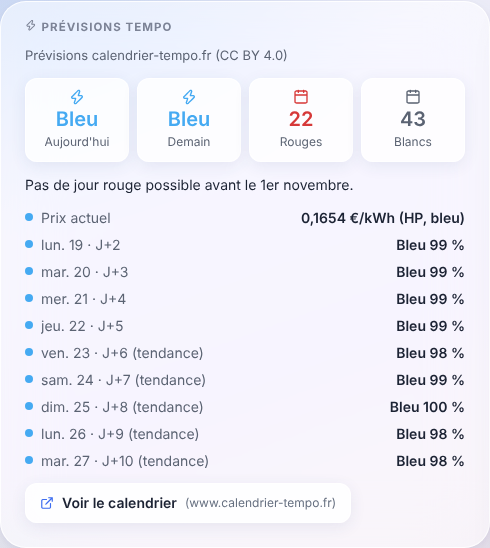

# Calendrier Tempo EDF pour Gladys Assistant

[](https://github.com/thomasissa-png/gladys-calendrier-tempo/actions/workflows/ci.yml)

Intégration Gladys Assistant qui ajoute la **couleur Tempo EDF** du jour et de demain, les **prévisions jusqu'à 15 jours**, le prochain jour rouge et blanc, les jours rouges et blancs restants dans la saison, le prix du kWh en cours, un widget de tableau de bord « Prévisions Tempo » et trois déclencheurs de scène.

Les données viennent de l'[API publique et gratuite de calendrier-tempo.fr](https://www.calendrier-tempo.fr/api-tempo) : aucun compte, aucune clé, rien à configurer.

Gladys affiche déjà la couleur officielle du jour et du lendemain avec son service EDF Tempo. Cette intégration le complète : prévisions de J+2 à J+15, jours restants, widget sur 15 jours et déclencheurs de scène qui n'existent pas ailleurs dans Gladys. Elle n'écrit pas dans le calendrier tarifaire `tempo` de Gladys (réservé aux couleurs officielles et au calcul des coûts).



## Fiabilité : ce qui fait foi, ce qui est prévu

| Horizon                              | Fiabilité    | Ce que cela veut dire                                                                |
| ------------------------------------ | ------------ | ------------------------------------------------------------------------------------ |
| Aujourd'hui, demain une fois annoncé | `officielle` | Couleur publiée par EDF. **Seule elle fait foi.**                                    |
| J+2 à J+5                            | `fiable`     | Prévision. C'est la zone sur laquelle le site mesure sa performance, la plus fiable. |
| J+6 à J+15                           | `indicative` | Prévision à longue échéance : une tendance, pas une certitude.                       |

Les taux de réussite, calculés sur les prévisions réellement émises, sont publiés sur la page [méthodologie](https://www.calendrier-tempo.fr/methodologie) : cette intégration n'en affiche aucun.

## Installation

Version minimale : Gladys Assistant 5.1.

1. Dans Gladys, ouvrez **Intégrations**, cherchez **Calendrier Tempo EDF** dans le catalogue et cliquez sur **Installer**. Vous pouvez aussi installer l'intégration depuis l'adresse de ce dépôt : `https://github.com/thomasissa-png/gladys-calendrier-tempo`.
2. Une fois l'intégration démarrée, ouvrez son onglet **Découverte** et créez l'appareil **Calendrier Tempo EDF**. L'intégration ne crée jamais d'appareil seule.
3. Pour le widget : **Tableau de bord > Modifier > Ajouter un widget**, puis **Prévisions Tempo**.

Les mises à jour s'installent en un clic depuis Gladys.

## L'appareil

| Fonctionnalité                    | Valeur                                                                                        | Fiabilité                           |
| --------------------------------- | --------------------------------------------------------------------------------------------- | ----------------------------------- |
| Aujourd'hui (officielle)          | `bleu`, `blanc` ou `rouge`                                                                    | officielle                          |
| Couleur actuelle                  | couleur qui s'applique maintenant : celle de la veille jusqu'à 6 h                            | officielle                          |
| Période tarifaire                 | `hp` (heures pleines, 6 h à 22 h) ou `hc` (heures creuses), heure de Paris                    |                                     |
| Prix actuel du kWh                | prix en euros TTC de la couleur et de la période en cours (veille jusqu'à 6 h)                | grille publiée par l'API            |
| Prix HP du jour, Prix HC du jour  | prix en euros TTC des heures pleines et creuses de la journée Tempo en cours                  | idem                                |
| Demain (officielle)               | `bleu`, `blanc` ou `rouge`, `inconnue` tant qu'EDF n'a pas annoncé                            | officielle                          |
| Prévision J+2 à Prévision J+5     | couleur prévue dans 2, 3, 4 ou 5 jours                                                        | fiable                              |
| Prévision J+6 à J+15 (indicative) | couleur prévue dans 6 à 15 jours, **seulement si l'option est activée**                       | indicative                          |
| Jours rouges sur 15 jours         | nombre de jours rouges, officiels ou prévus, d'aujourd'hui à J+15                             | selon le jour                       |
| Prochain jour rouge               | date (`AAAA-MM-JJ`) du prochain jour rouge, officiel ou prévu, `aucun` si aucun sur l'horizon | selon le jour                       |
| Prochain jour blanc               | date du prochain jour blanc, officiel ou prévu, ou `aucun`                                    | selon le jour                       |
| Jours rouges restants             | jours rouges restants dans la saison                                                          | compteurs EDF, sinon calcul du site |
| Jours blancs restants             | jours blancs restants dans la saison                                                          | idem                                |

Les couleurs sont publiées en minuscules (`bleu`, `blanc`, `rouge`, `inconnue`) : dans vos scènes, comparez avec ces valeurs. La journée Tempo va de 6 h à 6 h : pour piloter un chauffage, utilisez **Couleur actuelle**, qui garde la couleur de la veille jusqu'à 6 h.

Les prix viennent de la grille publiée par l'API (`/api/today`, champ `tarifs`) : aucun prix n'est écrit dans l'intégration. Une réponse sans grille garde la dernière grille lue, sans limite de durée (la grille ne change qu'à sa date d'effet, deux fois par an), jusqu'à la lecture d'une nouvelle grille ; si aucune grille n'a jamais été lue, ou si la couleur de la journée Tempo en cours n'est pas connue, le prix est inconnu et n'est pas publié. Gladys affiche ces valeurs en euros avec 3 chiffres significatifs et un point décimal, même en français (« 0.165 € ») ; la valeur enregistrée, utilisable dans les scènes, est exacte (0.1654).

Les prévisions J+6 à J+15 sont désactivées par défaut : tout l'horizon est déjà dans le widget et dans « Jours rouges sur 15 jours ». Pour les publier, activez l'option dans l'onglet **Configuration**, puis mettez à jour l'appareil depuis l'onglet **Découverte**.

## Le widget « Prévisions Tempo »

- Quatre tuiles : aujourd'hui, demain (couleur officielle, ou prévision signalée comme telle avant l'annonce), « Rouges » et « Blancs » (jours restants dans la saison).
- Un graphique de la probabilité de jour rouge, d'aujourd'hui à J+15, en % de 0 à 100 : aire « Rouge » et aire « Bleu ou blanc », demain marqué quand EDF l'a annoncé rouge ou blanc. Quand aucun jour de l'horizon ne peut être rouge (un rouge n'est possible que du 1er novembre au 31 mars, hors week-ends et jours fériés), il laisse la place au message « Pas de jour rouge possible avant le 1er novembre. ».
- Une liste : « Prix actuel » (par exemple « 0,1654 €/kWh (HP, bleu) », si l'API publie la grille de prix), puis J+2 à J+10 (J+11 sans prix) avec la couleur prévue et sa probabilité. Quand la prévision hésite entre deux couleurs dont le rouge (même règle que le site), la ligne nomme les deux, la couleur prévue d'abord, avec leurs deux probabilités : « Blanc ou rouge ? 50 % / 45 % ». Le point de la ligne reste la couleur prévue (Gladys n'a qu'une couleur par ligne), comme les fonctionnalités et les scènes.
- Un lien vers le [calendrier complet](https://www.calendrier-tempo.fr/calendrier).

Gladys impose ses propres couleurs de widget : le bleu Tempo s'affiche en bleu « information », le blanc en gris neutre, le rouge en rouge « alerte ». Limites du rendu de Gladys, hors de portée de l'intégration : les graduations du graphique s'affichent « 50.00 », sans « % » (le contrat des widgets n'a ni format ni unité d'axe : l'unité est dans le titre) ; sur un téléphone, la barre flottante du tableau de bord peut masquer les dernières lignes du widget (le contrat n'a pas de marge : faites défiler la page).

## Déclencheurs de scène

| Déclencheur                      | Quand                                                 | Filtre                             | Variables                                                      |
| -------------------------------- | ----------------------------------------------------- | ---------------------------------- | -------------------------------------------------------------- |
| Couleur Tempo de demain annoncée | EDF vient de publier la couleur de demain (vers 11 h) | couleur                            | `couleur`, `date`                                              |
| Jour rouge prévu                 | une date de J+2 à J+15 passe en rouge prévu           | fiabilité (`fiable`, `indicative`) | `date`, `jours_avant`, `probabilite_rouge` (en %), `fiabilite` |
| Journée Tempo commencée          | à 6 h, début d'une journée Tempo                      | couleur                            | `couleur`, `date`                                              |

Chaque événement n'est envoyé qu'une fois par transition, même après un redémarrage (le dernier état émis est gardé dans le dossier `/data` de l'intégration). À l'installation, l'état présent est seulement mémorisé : rien ne se déclenche. Si Gladys démarre après 7 h, « Journée Tempo commencée » n'est pas rattrapé pour ce jour-là.

Pour une scène sur une fonctionnalité de l'appareil (par exemple « Couleur actuelle égale à rouge »), préférez les déclencheurs de l'intégration ci-dessus, ou cochez l'option de seuil de Gladys : l'intégration n'envoie une couleur que lorsqu'elle change, mais Gladys peut réévaluer une scène sans seuil à chaque valeur reçue.

### Exemples

- **Veille d'un jour rouge** : déclencheur « Couleur Tempo de demain annoncée », couleur `Rouge` ; action « Envoyer un message » : « EDF annonce un jour rouge demain : pensez à décaler vos usages. »
- **Anticiper** : déclencheur « Jour rouge prévu », fiabilité `J+2 à J+5` ; action « Envoyer un message » avec les variables du déclencheur (date, dans combien de jours, probabilité). Seule la couleur publiée par EDF fait foi.
- **Chauffage** : déclencheur « Journée Tempo commencée », couleur `Rouge` ; actions sur vos radiateurs. Ou, sans déclencheur dédié, une condition sur la fonctionnalité « Couleur actuelle ».

## Rafraîchissement

Heure de Paris, quel que soit le fuseau de votre installation : toutes les 30 minutes (4 petites requêtes), à 0 h 05 pour le changement de jour, et à 11 h 35 pour la couleur de demain annoncée par EDF. Ces deux rendez-vous sont décalés de 0 à 120 secondes, une valeur tirée au hasard une fois pour toutes à l'installation, pour ne pas faire arriver toutes les installations en même temps. À minuit, à 6 h et à 22 h, le jour, la couleur actuelle et la période sont recalculés sans appel à l'API.

Si les prévisions ou les jours restants ne répondent pas, les dernières valeurs reçues sont conservées 24 h au plus. Si les couleurs officielles ne répondent pas, l'écran Configuration de l'intégration affiche « déconnecté » ; les couleurs officielles déjà lues restent affichées pour leur date, y compris après un redémarrage (elles sont gardées dans `/data`), et seule une couleur jamais lue passe à `inconnue`. Les prix, eux, ne peuvent pas passer à « inconnu » (Gladys n'a pas d'état inconnu pour une valeur en euros) : sans grille jamais lue ou sans couleur du jour connue, ils ne sont plus publiés et gardent leur dernière valeur, datée. Dans une scène sur un prix, ajoutez la condition « Couleur actuelle différente de `inconnue` ». Au redémarrage, rien n'est publié avant la première lecture : les couleurs ne passent jamais par `inconnue`. Après un échec, une seule nouvelle tentative a lieu 5 minutes plus tard, puis le cycle de 30 minutes reprend, sans relance en rafale.

L'intégration n'envoie aucune donnée personnelle : de simples lectures de l'API, avec le User-Agent `CalendrierTempo-Gladys/<version>`.

## Développement

```bash
npm install
npm test               # tests node:test, contre le faux Gladys du SDK
npm run lint           # ESLint
npm run format:check   # Prettier
docker build -t gladys-calendrier-tempo:dev .
```

Pour lancer le code hors conteneur contre un Gladys en mode développeur, ajoutez `CALENDRIER_TEMPO_DATA_DIR=./data` aux trois variables `GLADYS_*` (l'état est sinon écrit dans `/data`).

Les tests utilisent des réponses réelles de l'API, enregistrées et datées dans `test/fixtures/`. Le code de lecture reprend celui de l'[intégration Home Assistant](https://github.com/thomasissa-png/ha-calendrier-tempo) du même projet.

## Liens

- Calendrier et prévisions : [calendrier-tempo.fr](https://www.calendrier-tempo.fr/)
- Documentation de l'API : [calendrier-tempo.fr/api-tempo](https://www.calendrier-tempo.fr/api-tempo)
- Méthode de prévision et taux de réussite publiés : [calendrier-tempo.fr/methodologie](https://www.calendrier-tempo.fr/methodologie)
- Signaler un problème : [tickets GitHub](https://github.com/thomasissa-png/gladys-calendrier-tempo/issues), ou jean-pierre@calendrier-tempo.fr ; faille de sécurité : voir [SECURITY.md](SECURITY.md)

Données sous licence CC BY 4.0 (source : [calendrier-tempo.fr](https://www.calendrier-tempo.fr/)). Service gratuit et indépendant, sans garantie de disponibilité, non affilié à EDF ni à RTE.

## English

Gladys Assistant integration for the French **EDF Tempo** electricity tariff, with **forecasts up to 15 days ahead**. It adds a "Calendrier Tempo EDF" device (created in one click from the Discovery tab) with today's and tomorrow's official color, the current color (the Tempo day runs from 6:00 to 6:00), the tariff period (`hp` or `hc`), the current, peak and off-peak price per kWh (from the price grid published by the API), D+2 to D+5 forecasts, the number of red days in the next 15 days, the next red and white day, and the red and white days left in the season. D+6 to D+15 forecast features are optional (off by default). It also provides a "Tempo forecasts" dashboard widget (15-day chance of a red day) and three scene triggers: tomorrow's color announced, red day forecast, Tempo day started.

Reliability: `officielle` = color published by EDF, the only authoritative one; `fiable` = D+2 to D+5, the range where the site measures its performance, the most reliable one; `indicative` = D+6 to D+15, a trend rather than a certainty. Success rates are published on the [methodology page](https://www.calendrier-tempo.fr/methodologie), not in this integration.

Data comes from the free public API of [calendrier-tempo.fr](https://www.calendrier-tempo.fr/api-tempo) (no account, no key). Requires Gladys Assistant 5.1 or later. Colors are `bleu` (blue), `blanc` (white), `rouge` (red) and `inconnue` (unknown). Updates every 30 minutes, at 0:05 and at 11:35 (Paris time, plus a fixed random delay of 0 to 120 seconds per installation), with a single retry 5 minutes after a failure. It does not write to the Gladys `tempo` tariff calendar. Not affiliated with EDF or RTE.

## Licence

[MIT](LICENSE)
